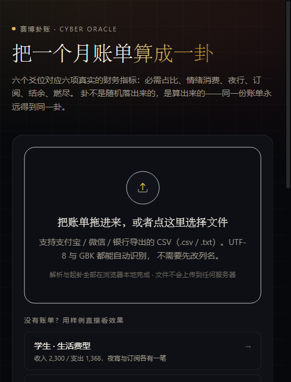
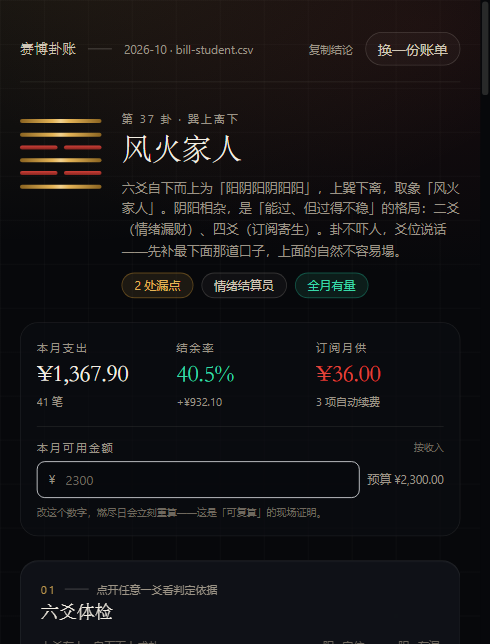
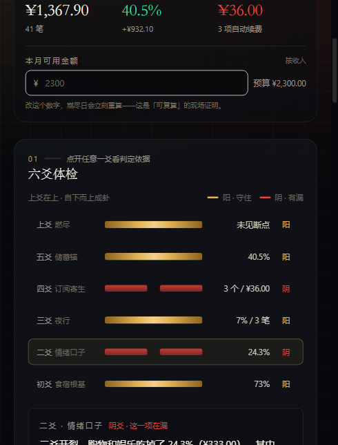

# 赛博卦账 · Cyber Oracle

> 把一个月账单算成一卦：大学生消费人格与生存预测看板。
> 全国高校 Vibe Coding 开发挑战赛 · 主题「重塑范式」· 推荐方向 6：校园 / 垂直社区全栈 MVP 平台。
> 仓库地址：<https://github.com/kiwi14-afk/cyber-oracle>（提交版本 tag：`v1.0-submit`）

上传一份支付宝 / 微信导出的 CSV，浏览器本地解析后，用六个真实财务指标起一卦：

| 爻位 | 在算什么 | 阈值（阴爻 = 有漏） |
| --- | --- | --- |
| 初爻 · 食宿根基 | 必需支出占全部支出 | 低于 60% |
| 二爻 · 情绪口子 | 购物 + 娱乐占比 | 高于 20% |
| 三爻 · 夜行 | 23:00–05:00 支出笔数占比 | 高于 12% |
| 四爻 · 订阅寄生 | 自动续费商户数 | 多于 2 个 |
| 五爻 · 储蓄锚 | 结余率 | 低于 15% |
| 上爻 · 燃尽 | 预算烧穿日 | 早于第 26 天 |

结果是**可复算的**：同一份账单永远得到同一卦、同一个燃尽日、同一套处方。
卦不是随机落出来的，是算出来的；AI 只负责把算好的结构讲成人话。





---

## 1. 10 分钟极速复现

### 前置条件

| 项 | 要求 | 说明 |
| --- | --- | --- |
| Node.js | ≥ 20（实测 v22.23.2） | 只依赖 Node 原生 `TextDecoder` / `fetch`，无需额外编译工具 |
| npm | ≥ 10 | 使用 `package-lock.json` 锁定依赖树 |
| 浏览器 | Chrome / Edge / Safari 新版 | 需要 `TextDecoder("gb18030")`，三大浏览器均已原生支持 |
| 网络 | 仅首次 `npm ci` 需要 | 仓库不含在线字体与 CDN 资源，装完依赖后可断网运行 |
| 可选 | 一个兼容 OpenAI 协议的 API Key | 不配也能完整体验：卦象、画像、燃尽、处方全部本地生成 |

### 四步跑通（约 3 分钟）

```bash
# 1) 安装依赖（严格按 lock 文件，避免版本漂移）
npm ci

# 2) 启动开发服务器（会自动把 samples/ 同步到 public/samples/）
npm run dev
#    打开 http://localhost:3000

# 3) 点首页「学生 · 生活费型」样例，3 秒看到完整卦盘
#    或把自己的账单 CSV 拖进上传区

# 4) 想验证「同一份账永远同一卦」：终端里再算一遍
npm run inspect -- samples/bill-student.csv
```

第 4 步会在终端直接打印卦象、六爻判定、卦辞、燃尽日与三剂处方，与网页结果逐字一致。

### 接入真实模型（可选，2 分钟）

```bash
cp .env.example .env.local        # Windows: copy .env.example .env.local
```

编辑 `.env.local`：

```ini
AI_BASE_URL=https://ark.cn-beijing.volces.com/api/v3   # 豆包方舟；也可换 DeepSeek / OpenAI / 智谱
AI_API_KEY=你的Key
AI_MODEL=ep-xxxxxxxx                                   # 方舟填推理接入点 ID，其他厂商填模型名
```

重启 `npm run dev` 后：

- 「卦辞」面板从**本地模式**切换为**流式 AI 模式**，逐字返回；
- 「追问卦师」可基于同一份卦案回答问题。

**不配 Key 不是错误路径**：服务端检测不到 Key 时返回 `{ mode: "local" }`，前端继续展示本地卦辞，并在角落标明原因。上游超时 / 401 / 500 同样降级，不会白屏。

### 验证工程质量（约 2 分钟）

```bash
npm run typecheck     # tsc --noEmit，strict 模式，0 error
npm test              # 26 个单测，覆盖解析边界、编码、卦象、燃尽、处方、确定性
npm run build         # 生产构建
```

单测里有一条硬约束：**同一份账单连续计算两次，`JSON.stringify` 结果逐字节相等**。这是「可复现」的程序化证明，而不是文案承诺。

---

## 2. 环境变量与依赖清单

### 环境变量模板（`.env.example`）

| 变量 | 必填 | 默认 | 说明 |
| --- | --- | --- | --- |
| `AI_BASE_URL` | 否 | `https://ark.cn-beijing.volces.com/api/v3` | 兼容 OpenAI `/chat/completions` 的服务地址 |
| `AI_API_KEY` | 否 | 空 | 为空即进入本地模式；**绝不入库** |
| `AI_MODEL` | 否 | 空 | 与 Key 同时存在才启用 AI |

### 依赖清单（全部锁定在 `package-lock.json`）

| 依赖 | 版本 | 用途 |
| --- | --- | --- |
| next | ^15.5.0 | App Router、服务端路由、构建 |
| react / react-dom | ^19.1.0 | 前端框架 |
| typescript | ^5.9.0 | strict 类型约束 |
| tailwindcss | ^3.4.17 | 设计令牌与样式 |
| echarts | ^5.6.0 | 燃尽曲线（按需引入 core + line + grid + tooltip + markLine） |
| papaparse | ^5.5.3 | CSV 解析（无 header，自行探测表头） |
| vitest | ^2.1.9 | 单元测试 |
| vite-node | ^6.0.0 | 终端 CLI（`npm run inspect`） |

没有引入任何 UI 组件库、图表封装库、状态管理库或在线字体 —— 首页 JS 139 kB，其中 echarts 只在卦盘渲染时按需加载。

---

## 3. 目录结构与分层约束

```
src/
├─ domain/                 # 纯函数领域层：不依赖 React / Next / 浏览器 API
│  ├─ types.ts             #   全部领域类型；金额一律 int 分
│  ├─ parse/
│  │  ├─ values.ts         #   金额 / 时间解析（¥、千分位、中文日期、Excel 序列号）
│  │  ├─ decode.ts         #   编码自适应（UTF-8 BOM → UTF-16LE → GB18030 → 兜底）
│  │  ├─ csv.ts            #   表头探测式 CSV 解析、方向列、多月份、坏行跳过
│  │  └─ normalize.ts      #   商户归一化（去渠道前缀 / 公司后缀 / 门店名 / 订单号）
│  ├─ categories.ts        #   12 个分类 + 必需标记 + 订阅识别
│  ├─ ledger.ts            #   账本聚合（分类 / 日 / 小时 / 订阅 / 周末 / 中位数）
│  ├─ runway.ts            #   燃尽引擎（中位日耗 → 外推 → 燃尽日）
│  ├─ hexagram.ts          #   六爻判定 + 八卦编码 + 64 卦表 + 卦辞生成
│  ├─ persona.ts           #   8 种消费人格（按最疼的一爻映射）
│  ├─ prescription.ts      #   处方引擎（按可省金额排序取前三）
│  └─ oracle.ts            #   编排层 + 统一 re-export
├─ lib/ai/                 # AI 薄层：信封 / 提示词 / 上游调用 / SSE 解析 / 本地卦辞
├─ components/             # 视觉层：六爻、燃尽、分类、人格、处方、卦辞、追问
└─ app/                    # Next.js 页面与 /api/oracle、/api/chat 两个流式路由
```

依赖方向严格单向，不允许回指：

```
parse → categories → ledger → runway ─┐
                    └→ hexagram ← persona ┘→ prescription → oracle → UI
```

这样做的收益是具体的：领域层可以被 vitest 直接跑（26 个单测 1.3 秒），可以被 CLI 直接调（`npm run inspect`），也可以在浏览器里直接跑（`parseBillBuffer` / `buildOracle`）。同一套代码，三种入口，结果一致。

### 三条不可违背的约定

1. **金额只用「分」整数**：`amountCents`，浮点只在展示层出现（`formatCents`）。
2. **时间只用 epoch + 本地日期串**：解析时就把时区问题解决掉，聚合层不再碰 `Date`。
3. **领域层无副作用**：没有 `Date.now()`、没有 `Math.random()`、没有 IO —— 这是「同一份账永远同一卦」的前提。

---

## 4. 四份样例的固定输出（回归基线）

四份样例均为虚构脱敏数据，随仓库分发；数值同时被 `tests/engine.test.ts` 断言，改坏了测试会红。

| 样例 | 结构 | 收入 / 支出 / 结余率 | 卦象 | 人格 | 燃尽 | 处方合计 |
| --- | --- | --- | --- | --- | --- | --- |
| `bill-student.csv` | 生活费型，43 笔，UTF-8 | ¥2,300 / ¥1,367.90 / 40.5% | 第 37 卦 风火家人（上巽下离） | 情绪结算员 | 不会见底 | ¥181.79/月 |
| `bill-moonlight.csv` | 月光工资型，52 笔 | ¥6,200 / ¥6,647.00 / -7.2% | 第 2 卦 坤为地（六爻全阴） | 赛博散财童子 | 第 23 天 | ¥1,740.95/月 |
| `bill-steady.csv` | 稳健结余型，26 笔 | ¥9,500 / ¥6,403.00 / 32.6% | 第 1 卦 乾为天（六爻纯阳） | 铁算盘 | 不会见底 | ¥458.06/月 |
| `bill-wechat-gbk.csv` | 微信导出，**GB18030** 编码，26 笔 | ¥9,199 / ¥1,126.90 / 87.7% | 第 25 卦 天雷无妄（上乾下震） | 情绪结算员 | 不会见底 | ¥207.41/月 |

三份 UTF-8 样例覆盖「能过但不稳」「全线失守」「六爻皆稳」三种极端；第四份专门用 GBK 编码 + 微信列名，验证编码识别与列名映射不是对着支付宝格式写死的。

---

## 5. 隐私设计（不是口号，是架构结果）

| 环节 | 数据在哪 | 说明 |
| --- | --- | --- |
| 读取 CSV | 浏览器内存 | `File.arrayBuffer()`，不发起上传请求 |
| 解码 / 解析 / 起卦 | 浏览器内存 | 领域层纯函数直接在 client 执行 |
| 送给模型的内容 | 聚合信封（约 1 KB） | 只有金额、占比、卦象、处方文本；**不含商户明细与原始流水** |
| 落盘 | 不落盘 | 不写 IndexedDB、不写 localStorage，刷新即清 |
| 仓库 | 只有虚构样例 | `.gitignore` 拦截 `*.private.*`、`/data/private/`、`.env.local` |

一个可验证的细节：卦盘页面渲染期间打开浏览器 Network 面板，除 `/api/oracle` 的一次小请求外没有任何账单数据上行。

---

## 6. 常用命令

| 命令 | 作用 |
| --- | --- |
| `npm run dev` | 开发服务器（3000） |
| `npm run build` / `npm start` | 生产构建与启动 |
| `npm run typecheck` | `tsc --noEmit` |
| `npm test` | 26 个单测 |
| `npm run inspect -- samples/xxx.csv` | 终端起卦，支持 `--verbose` 打印分类明细 |
| `node scripts/sync-samples.mjs` | 把 `samples/` 同步到 `public/samples/`（`dev` / `build` 自动执行） |

---

## 7. 常见问题

**Q. 拖进去提示「没找到时间与金额这两列」？**
确认导出的是「交易明细 CSV」而不是 PDF 或截图转文本。表头里至少要能识别到时间与金额两列（支持 `交易时间 / 创建时间 / 时间`，`金额 / 金额(元) / 收支金额` 等写法）。

**Q. 微信账单是 GBK，会不会乱码？**
不会。解码顺序为 UTF-8 BOM → UTF-16LE → 严格 UTF-8 → GB18030 → 宽松 UTF-8 兜底，用 fatal 解码器「抛错即判断」，不猜编码。`samples/bill-wechat-gbk.csv` 就是这条路径的回归用例。

**Q. 我的账单跨了两个月？**
解析时只保留流水最多的那个月，并在页面上给出告警。这是刻意选择：混月会让燃尽日与结余率失真。

**Q. 为什么退款不算负支出？**
退款计为收入、支出不做负数抵扣，保证「支出总额」始终可解释。资金搬运（转账 / 还款 / 余额宝）整体排除在消费之外，避免信用卡账单重复计账。

**Q. 没有 API Key，答辩现场能演示 AI 吗？**
可以演示「本地模式」，它会输出完整的四段卦辞；也可以现场填一把 Key 再跑一次，体验流式切换。评审关注的是**意图控制策略**，而策略写在 `src/lib/ai/prompts.ts` 与 `src/lib/ai/payload.ts` 里，不依赖 Key 是否存在。

**Q. 端口 3000 被占用？**
`npm run dev -- -p 3100`。

---

## 8. 提交物索引（对照赛题要求）

| 赛题要求 | 本仓库对应位置 |
| --- | --- |
| 细粒度 Git 提交历史 | `git log`：25+ 次提交，按「一次对话 / 一个模块」切分，禁止 initial commit 一把梭 |
| Prompt 历史快照（≥3 条核心迭代） | [`docs/prompts/`](docs/prompts/)：账单解析、六爻判定、AI 卦辞意图控制三条完整 Prompt 链 |
| README 10 分钟复现指南 | 本文件第 1 节 |
| 演示视频 5–8 分钟（含 ≥2 分钟 AI 协同） | [`docs/演示视频脚本.md`](docs/演示视频脚本.md)：分镜、口播、录屏操作与时间码 |
| 技术文档 PDF ≤30 页 | [`docs/技术文档.pdf`](docs/技术文档.pdf)（源文件 `docs/技术文档.md`） |
| 提交自查 | [`docs/提交自查清单.md`](docs/提交自查清单.md) |

### 评分权重与本文档的对应

| 维度（权重） | 证据位置 |
| --- | --- |
| 过程可复现性与演进链路 25% | Git 历史 + `docs/prompts/` 三条链 + `docs/技术文档.md` 第 5 章 |
| 解题有效性与实用价值 25% | 燃尽日 / 三剂处方 / 真实样例基线（第 4 节） |
| 方法创新性与意图控制 20% | 信封 + 四段结构 + 数字禁算铁律（`src/lib/ai/`，技术文档第 2 章） |
| 工程质量与架构设计 15% | 单向依赖 + 纯函数 + 26 单测 + strict 类型（第 3 节） |
| 用户体验与产品精细度 15% | 六爻逐爻点亮、预算实时重算、无 Key 降级不白屏 |

---

## 9. 许可与声明

代码以 MIT 许可发布，仅供学习与竞赛评审使用。样例账单为程序生成的虚构数据，不含任何真实个人信息。
本项目不构成财务、投资或法律建议；处方只是基于账单结构的可执行建议。
